<p align="center">
  
</p>

<p align="center">
  <a href="https://nextjs.org"></a>
  <a href="https://www.typescriptlang.org"></a>
  <a href="https://tailwindcss.com"></a>
  <a href="https://vercel.com"></a>
  <a href="https://rxguard-9lj1.vercel.app/"></a>
  
</p>

<h3 align="center"><a href="https://rxguard-9lj1.vercel.app/"><b>Live Demo →</b></a></h3>

<p align="center">
  <i>A stateless, privacy-first web app that reads a prescription and a lab report together, catches drug-vs-lab conflicts, and turns both into a plain-language daily plan.</i>
</p>

<p align="center">
  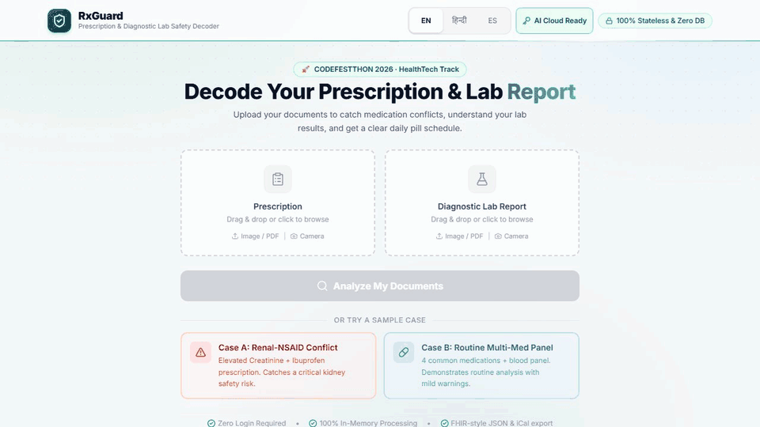
</p>

## 📸 Screenshots

<table>
  <tr>
    <td width="50%">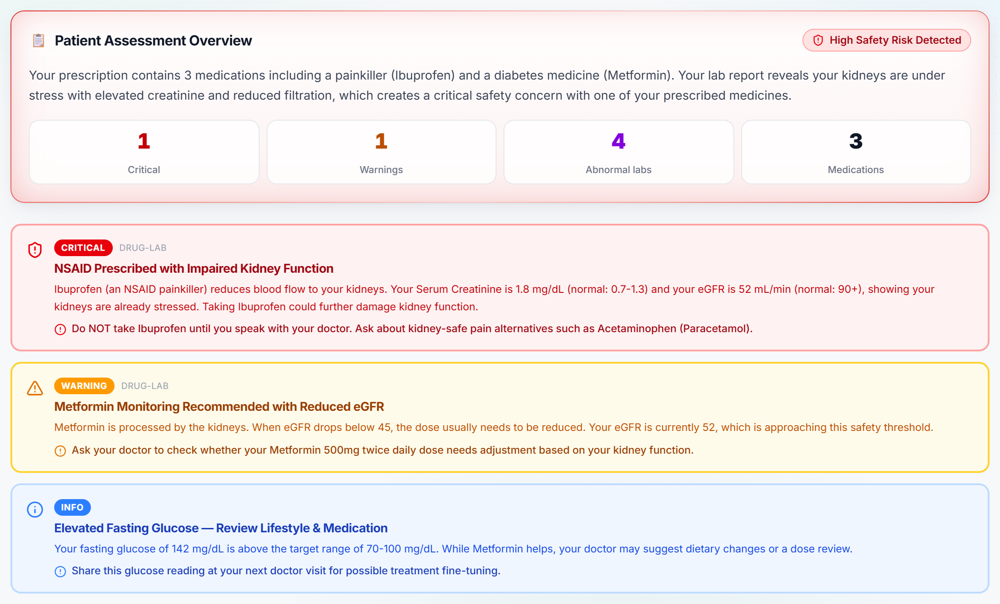<br><sub><b>Verdict + alerts.</b> Case A: Ibuprofen vs. creatinine 1.8 mg/dL and eGFR 52 raises a CRITICAL alert.</sub></td>
    <td width="50%">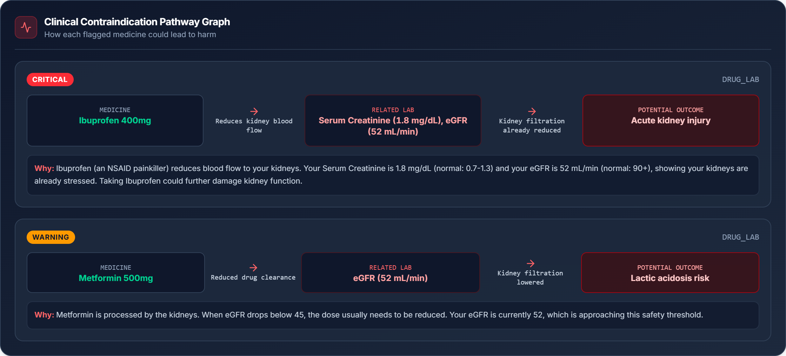<br><sub><b>Mechanism pathway.</b> Medicine → mechanism → related lab → potential outcome, built from each alert.</sub></td>
  </tr>
  <tr>
    <td width="50%">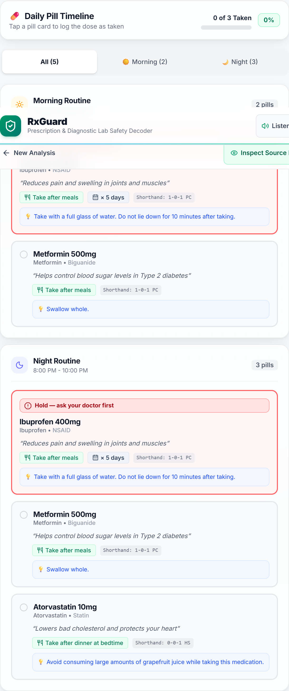<br><sub><b>Pill timeline.</b> The "Hold — ask your doctor first" badge keeps Ibuprofen out of the adherence count.</sub></td>
    <td width="50%">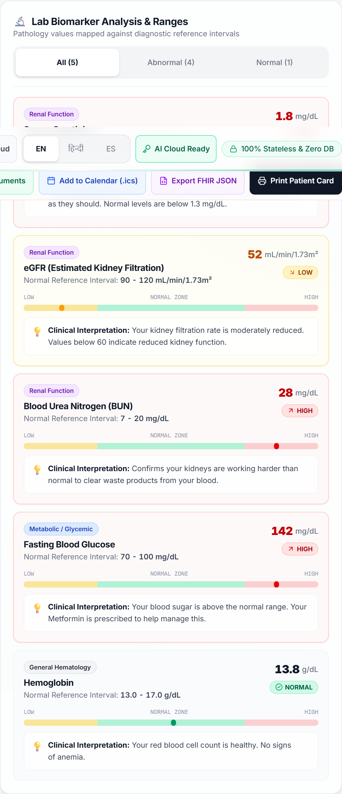<br><sub><b>Lab ranges.</b> LOW / NORMAL / HIGH bars with a status marker and plain-language interpretation.</sub></td>
  </tr>
</table>

<table>
  <tr>
    <td width="25%">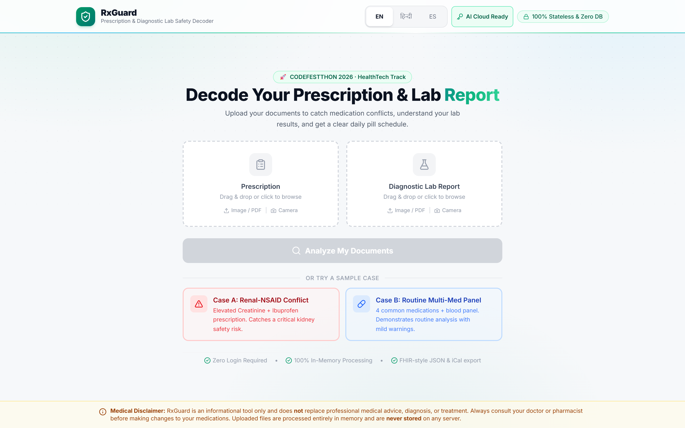<br><sub><b>Home.</b> Two upload zones and one-click sample cases.</sub></td>
    <td width="25%">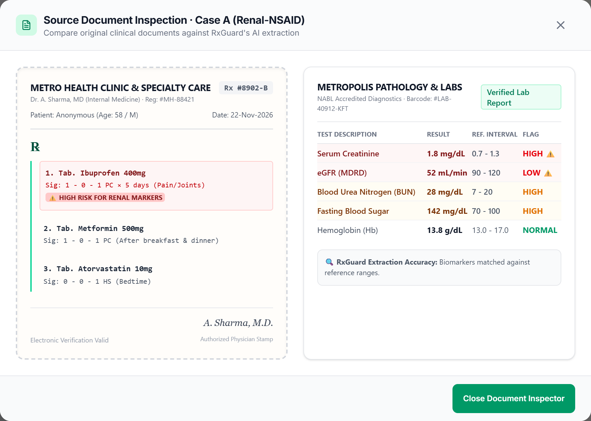<br><sub><b>Source inspector.</b> Original documents next to the extraction (samples).</sub></td>
    <td width="25%">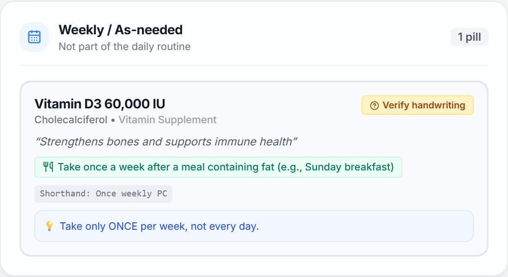<br><sub><b>Weekly dose.</b> Case B's Vitamin D3 gets its own card, outside the daily count.</sub></td>
    <td width="25%">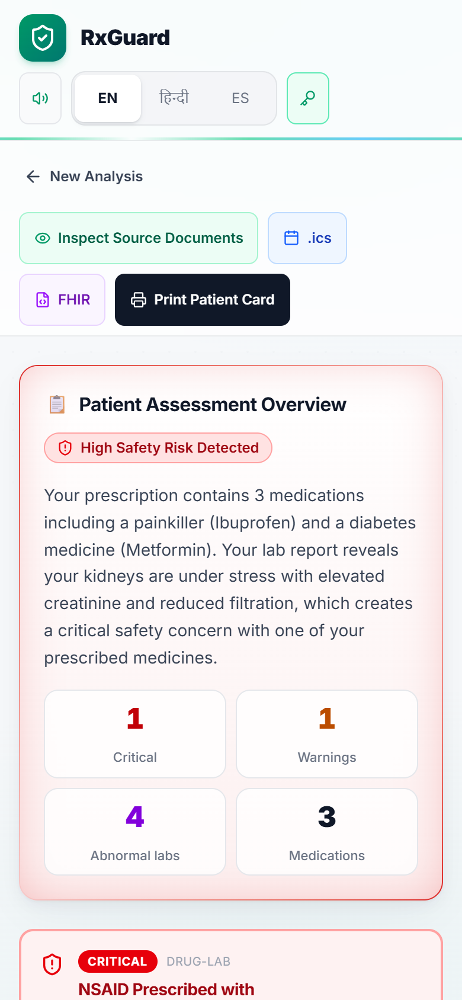<br><sub><b>Mobile.</b> The 390px layout.</sub></td>
  </tr>
</table>

<p align="center">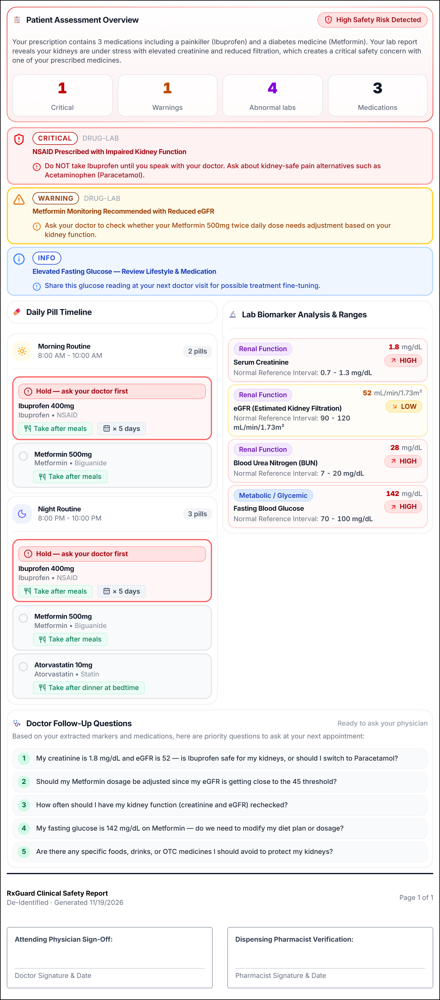<br><sub><b>Print patient card.</b> A compact, colour-safe layout with doctor and pharmacist sign-off boxes.</sub></p>

## ✨ Feature tour

- **Cross-document drug-vs-lab check:** Case A flags *Ibuprofen 400mg* against *Serum Creatinine 1.8 mg/dL* and *eGFR 52* as a CRITICAL alert (AI analysis plus a deterministic rule engine in `src/lib/clinical-rules.ts`).
- **"Hold — ask your doctor first" badge:** a medicine named in a CRITICAL alert gets a red card and badge, and is left out of the "X of Y Taken" adherence count.
- **Source Document Inspector:** side-by-side mock original prescription and lab panel next to what RxGuard extracted (sample cases only).
- **Mechanism pathway per alert:** *Medicine → mechanism → related lab → potential outcome* (e.g. Metformin → reduced drug clearance → lactic acidosis risk), with labels taken from each alert, not a fixed template.
- **Weekly-dose handling:** Case B's *Vitamin D3 60,000 IU* moves to a "Weekly / As-needed" card, outside the daily count, with a "Take Weekly, NOT Daily" warning.
- **Daily pill timeline with tap-to-log:** Morning / Afternoon / Night cards (empty slots hidden); tap a card to mark it taken.
- **Lab range bars with markers:** each result shows a LOW / NORMAL ZONE / HIGH bar with a status marker (position reflects status, not the exact value).
- **Doctor questions with one-tap copy:** a copy button on every suggested question.
- **Listen Aloud:** reads the overview, critical alerts and medication list using the browser's speech synthesis.
- **Hindi / Spanish switching:** instant for the sample cases (hand-written translations); uploads are AI-translated on demand and labelled "Translated by AI".
- **Add to calendar (.ics):** downloads daily-recurring morning / afternoon / night reminder events with a 5-minute alert.
- **FHIR-style JSON export:** a Bundle of Patient, MedicationRequest, Observation and DetectedIssue resources (not formally validated against FHIR R4).
- **Print patient card:** a compact print layout (about two A4 pages) with doctor and pharmacist sign-off boxes.
- **No login, nothing stored:** files are processed in memory and not saved by the app; the only thing kept is an optional API key you choose to enter, in your own browser.

## ⏱️ 90-second demo path

1. Open the [live demo](https://rxguard-9lj1.vercel.app/) and click **Case A: Renal-NSAID Conflict**.
2. Read the **verdict card**: high-risk badge plus counts for critical, warnings, abnormal labs and medications.
3. Scroll to the **pathway graph** and follow Ibuprofen → reduced kidney blood flow → acute kidney injury.
4. In the pill timeline, find the red **Hold — ask your doctor first** badge on Ibuprofen and note the adherence count excludes it.
5. Click **Inspect Source Documents** to compare the original prescription and lab report with the extraction; close it with Esc.
6. Switch the language to **हिन्दी** or **ES** and watch the alerts, overview and doctor questions change instantly.
7. Press **Listen Aloud** in the header to hear the report.
8. Scroll the **lab ranges** to see the HIGH/LOW markers and plain-language interpretations.
9. Use **Add to Calendar (.ics)** and **Print Patient Card**.
10. Click **New Analysis**, then **Case B** to see the weekly Vitamin D3 dose handled in its own card.

---

## 💡 The Problem

Every day, patients leave clinics and labs holding handwritten prescriptions they cannot read and dense blood panels they do not understand. Medication errors are a well-documented cause of avoidable harm worldwide ([WHO: Medication Without Harm](https://www.who.int/initiatives/medication-without-harm)).
- **Dosage shorthand confusion:** misreading `1-0-1 PC`, `TID`, `HS` or `SOS` can cause preventable errors.
- **Siloed documents:** prescriptions and lab tests are reviewed separately, and few clinicians have time to cross-check 20+ biomarkers against every new drug.
- **Privacy:** many health apps require accounts and keep records in remote databases.

## 🚀 The Solution

Upload or photograph a prescription and a lab report together. RxGuard uses multimodal vision AI with strict JSON-schema output to:
1. **Read prescriptions:** drug names, strengths, frequencies and food instructions.
2. **Decode biomarkers:** compare values with reference intervals and flag `HIGH` / `LOW` in plain language.
3. **Cross-check drugs against labs:** e.g. an NSAID prescribed when creatinine is elevated.
4. **Build a daily pill schedule:** morning, afternoon and night, with meal guidance.
5. **Prepare doctor questions:** 3 to 5 targeted questions for the next visit.
6. **Stay stateless:** no database, no logins, no saved files.

## 🏆 Devfolio Judging Criteria Mapping

| Judging Criterion | How RxGuard Delivers |
|---|---|
| **Technicality** | Multi-provider AI pipeline (Claude Sonnet via OpenRouter or Anthropic, or Google Gemini Flash) with multimodal vision, strict server-side Zod validation and a deterministic drug-vs-lab rule engine. Built with Next.js 16 (App Router), TypeScript and Tailwind CSS 4. |
| **Originality** | Cross-document **drug-to-lab conflict detection** (e.g. creatinine + NSAID, eGFR + Metformin). Most tools only check drug-drug interactions. |
| **Practicality** | Targets a documented patient-safety problem (see the WHO link above). Works on any smartphone with no registration. |
| **Aesthetics (UI/UX)** | Clinical dashboard, severity-coded hierarchy (CRITICAL / WARNING / INFO), animated range bars, tap-to-log pill cards, and copy buttons on doctor questions. |
| **"Wow" factor** | **One-click demo datasets** show real safety alerts without uploading medical files, plus a compact print-ready patient card. |

---

## 🛠️ Architecture

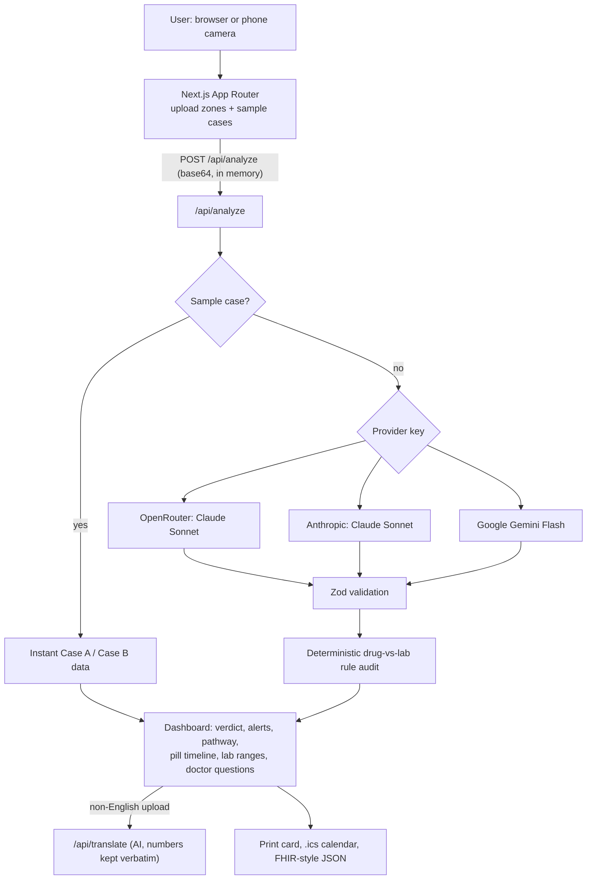

<details>
<summary>Text version</summary>

```
User (Browser / Mobile Camera)
      │
      ▼
Next.js App Router (Upload Zone & One-Click Sample Triggers)
      │
      ▼  POST /api/analyze (Stateless Base64 In-Memory)
      ├──► Sample Interceptors (Instant Case A / Case B for Judges)
      └──► AI provider: OpenRouter / Anthropic Claude Sonnet or Google Gemini Flash
                │
                ▼ (Strict Response Schema)
           Zod Server-Side Validation
                │
                ▼
           Deterministic drug-vs-lab rule audit
                │
                ▼
Clinical Safety Dashboard:
  ├── 🚨 Top Severity Alert Banners (Critical / Warning / Info)
  ├── 📋 Patient Plain-Language Overview
  ├── 💊 Morning / Afternoon / Night Visual Pill Timeline
  ├── 🔬 Biomarker Reference Range Visualizers
  ├── 🩺 Targeted Doctor Follow-up Questions Card
  └── 🖨️ Compact Printable Patient Card
```

</details>

---

## ⚡ Quickstart & Running Locally

### 1. Prerequisites
- Node.js 20+
- *(Optional, for live uploads)* one AI key. The sample cases work with no key.

### 2. Setup
```bash
git clone https://github.com/AbrarShuvo/rxguard.git
cd rxguard
npm install
cp .env.local.example .env.local
```

Add **one** of these to `.env.local`:

| Variable | Provider | Notes |
|---|---|---|
| `OPENROUTER_API_KEY` | OpenRouter (Claude Sonnet) | Key starts with `sk-or-`. Checked first. Optional `OPENROUTER_MODEL`. |
| `ANTHROPIC_API_KEY` | Anthropic (Claude Sonnet) | Key starts with `sk-ant-`. Optional `ANTHROPIC_MODEL`. An `sk-or-` key placed here is detected and routed to OpenRouter. |
| `GEMINI_API_KEY` | Google Gemini | Key starts with `AIza`. Optional free-tier fallback. |

You can also paste a key into the app's **API Key** button; it is kept only in your browser.

### 3. Run
```bash
npm run dev
```

Open [http://localhost:3000](http://localhost:3000).

---

## 🧪 Testing with sample cases (zero config)

Click either demo button on the home screen:
- **Case A: Renal-NSAID Conflict:** Serum Creatinine 1.8 mg/dL and eGFR 52 mL/min with Ibuprofen 400mg. Triggers a **CRITICAL** alert and suggests Paracetamol as an alternative to discuss with a doctor.
- **Case B: Routine Multi-Medication Panel:** Amlodipine, Pantoprazole, Metformin and a weekly Vitamin D3, with borderline cholesterol. Shows routine timeline organisation and weekly-dose handling.

## 🔒 Privacy & Compliance
- **No server-side storage:** uploaded images are processed in memory for the request and are not written to disk or a database by this app. (They are sent to the AI provider you configure.)
- **Medical disclaimer:** a non-diagnostic notice is shown on every screen.

## ⚠️ Known Limitations & Disclaimer

RxGuard is an educational hackathon project, **not a medical device**. It does not provide medical advice, diagnosis or treatment. Always confirm with a doctor or pharmacist.

- AI reading of handwriting and low-quality photos can be wrong; every extraction should be checked against the original.
- The deterministic rule engine covers only a small set of drug-vs-lab rules; absence of an alert does not mean a combination is safe.
- Lab range markers show status (low / normal / high), not the exact position of the value.
- The Source Document Inspector shows built-in sample documents, not your uploaded files.
- The `.ics` export schedules every medicine as a daily event, including weekly or on-hold ones; check it before relying on it.
- Hindi and Spanish are hand-written for the sample cases only; uploads are machine-translated and labelled as such.
- The "FHIR-style" JSON export is not validated against FHIR R4.
- Listen Aloud depends on the voices installed in your browser.

## 🗺️ What's next
- Make the calendar export respect weekly doses and medicines on hold.
- Show the user's own uploaded files in the Source Document Inspector.
- Validate the FHIR export against R4 profiles.
- Expand the drug-vs-lab rule set (e.g. statins and liver enzymes) with clinician review.
- Position range markers by the actual value, and add more languages.

## 📄 License

Released under the [MIT License](LICENSE).
